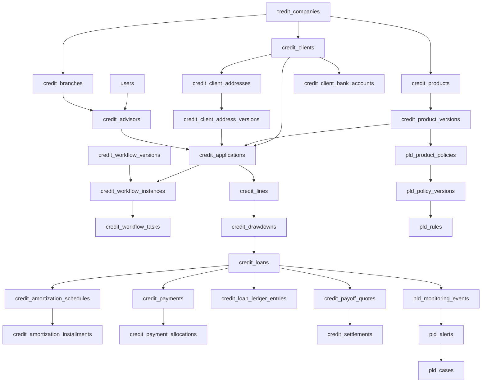
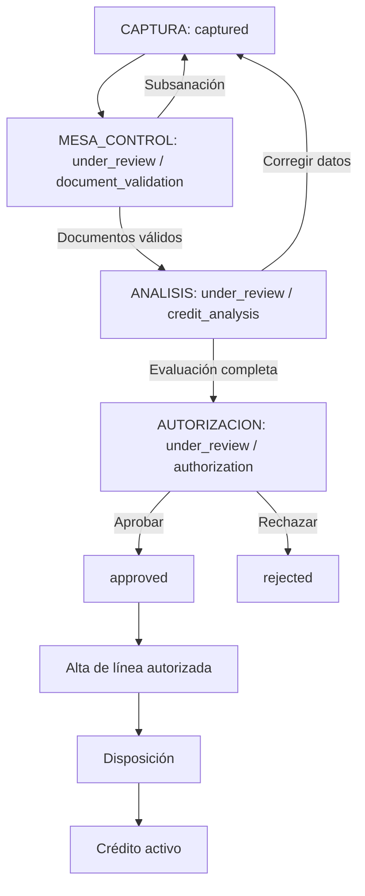

# FiduCredit V2 — Diccionario de datos y arquitectura relacional

**Versión del documento:** 1.0 · **Estado:** referencia del esquema implementado en `main` · **Fecha:** 21 de noviembre de 2026  
**Código fuente:** [davidgg2907/fiducreditv2](https://github.com/davidgg2907/fiducreditv2)  
**Ámbito:** arquetipo Laravel/Angular, Originación, motor de flujo, Administración de Crédito y PLD/FT.  
**Objetivo:** servir como fuente de consulta en sesiones futuras para desarrollar modelos Eloquent, requests, servicios, endpoints, validaciones, políticas de acceso, auditoría y frontend.

> **Fuente de verdad:** las migraciones PHP bajo `backend/database/migrations`. Este documento presenta el propósito y las principales columnas y FK; no reemplaza el SQL generado ni garantiza que los algoritmos o reglas operativas estén desarrollados. Los tipos y restricciones completos deben leerse siempre en la migración correspondiente.

## 1. Inventario y convenciones

| Bloque | Archivos de migración nuevos o heredados | Tablas físicas |
|---|---:|---:|
| Arquetipo, acceso y soporte | 11 archivos | 15 |
| Originación | 30 archivos | 30 |
| Flujos y mesa de control | 10 archivos | 10 |
| Administración y PLD | 43 archivos | 43 |
| **Total** | **94 archivos** | **98 tablas** |

- **Identificador:** las 83 tablas crediticias y PLD utilizan `id UUID`. Las tablas existentes del arquetipo mantienen sus tipos de PK, principalmente `BIGINT` y algunos identificadores string.
- **Relaciones:** `foreignUuid` para tablas crediticias; `foreignId` cuando el destino es `users` o `roles`. Las abreviaturas en este documento identifican las tablas destino, y `→` significa FK declarada salvo donde se indique relación lógica.
- **Dinero:** `DECIMAL(18,2)` para montos; tasas decimales con precisión indicada en cada migración. En PHP evitar float en cálculos contables definitivos.
- **Tiempo:** distinguir `created_at`, `occurred_at`, `received_at`, `posted_at` y `value_date`. Una fecha valor puede diferir de la fecha física de captura.
- **Versiones:** un registro aprobado o publicado debe permanecer históricamente accesible; las nuevas reglas se modelan creando una versión adicional.
- **Baja lógica:** la mayoría de las tablas no incluyen `softDeletes`. Usar estados operativos y evitar eliminación física de expedientes y movimientos, con retención conforme a régimen y política.
- **Auditoría:** historiales, movimientos y hechos PLD deben tratarse como append-only desde los servicios; el esquema por sí solo no impide un UPDATE administrativo.
- **Multientidad:** el alcance institucional se infiere de `company_id` y de las relaciones de cliente/producto/línea. Verificar en servicios que todas las FK relacionadas pertenezcan a la misma entidad: la presencia de FK independientes no asegura esa invariante.

## 2. Mapa de relaciones maestras



La flecha representa la dirección ilustrativa de relación, **no** siempre cardinalidad 1:1; leer las restricciones unique para identificar cardinalidades exactas.

## 3. Diccionario de tablas, columnas y referencias

### Arquetipo: identidad, seguridad y soporte Laravel

| Tabla | Responsabilidad | Campos de negocio principales | Relaciones FK |
|---|---|---|---|
| `users` | Cuentas de acceso; único superadministrador y rol asignado | id bigint; name, email, password, is_superadmin, role_id, mfa_secret, mfa_last_step | role_id → roles.id |
| `password_reset_tokens` | Tokens de restablecimiento | email PK, token, created_at | email lógico → users.email (sin FK) |
| `sessions` | Sesiones de Laravel | id string PK, user_id, ip_address, user_agent, payload, last_activity | user_id → users.id (índice; sin FK declarada) |
| `cache` | Almacenamiento de caché | key PK, value, expiration | — |
| `cache_locks` | Bloqueos de caché | key PK, owner, expiration | — |
| `jobs` | Cola de trabajos | id bigint, queue, payload, attempts, available_at | — |
| `job_batches` | Lotes de trabajos | id string PK, name, total_jobs, pending_jobs, failed_jobs | — |
| `failed_jobs` | Trabajos fallidos | id bigint, uuid, connection, queue, payload, exception | — |
| `oauth_access_tokens` | Tokens de acceso del backend | id, user_id, name, scopes, revoked, expires_at | user_id → users.id |
| `oauth_refresh_tokens` | Renovación de tokens OAuth | id, access_token_id, revoked, expires_at | access_token_id lógico → oauth_access_tokens.id |
| `auth_sessions` | Control de sesión de autenticación | user_id PK, access_token_id, remember, expires_at, last_activity_at | user_id → users.id |
| `roles` | Roles y permisos actuales del arquetipo | id bigint, name, permissions JSON | — |
| `access_modules` | Catálogo de módulos de seguridad | id, code, name | — |
| `module_actions` | Acciones y permisos del módulo | id, module_id, permission, name | module_id → access_modules.id |
| `menu_items` | Menú dinámico jerárquico | id, code, parent_id, module_action_id, label, route, icon | parent_id → menu_items.id; module_action_id → module_actions.id |

> El arquetipo contiene 11 migraciones que materializan 15 tablas de infraestructura y seguridad; varias migraciones crean más de una tabla. `users` se modifica además con campos de seguridad, sin crear una tabla adicional. Las llaves heredadas no se convierten a UUID.

### Originación: empresas, productos y expediente

| Tabla | Responsabilidad | Campos de negocio principales | Relaciones FK |
|---|---|---|---|
| `credit_companies` | Instituciones o empresas operadoras del sistema | legal_name, trade_name, rfc único, status | — |
| `credit_branches` | Sucursales de cada empresa | company_id, code, name, municipality, state, active | company_id → credit_companies |
| `credit_advisors` | Asesores vinculados a usuario, empresa y sucursal | employee_code, user_id, company_id, branch_id, active | user_id → users; company_id → credit_companies; branch_id → credit_branches |
| `credit_products` | Producto y subproducto mediante jerarquía | company_id, parent_product_id, code, name, status | company_id → credit_companies; parent_product_id → credit_products |
| `credit_product_versions` | Reglas financieras publicables por versión de producto | product_id, version, montos y plazos min/max, tasas min/max, max_dti, min_bureau_score, rate_type, currency, amortization_method, payment_frequency | product_id → credit_products |
| `credit_product_fees` | Comisiones propias de una versión de producto | product_version_id, code, calculation_type, amount, taxable | product_version_id → credit_product_versions |
| `credit_product_rules` | Condiciones de aceptación y rechazo del producto | product_version_id, rule_code, operator, rule_value JSON, rejection_reason | product_version_id → credit_product_versions |
| `credit_custom_fields` | Campos dinámicos definidos por institución | company_id, field_key, label, data_type, options JSON, sensitive | company_id → credit_companies |
| `credit_product_fields` | Campos por versión, visibles y obligatorios | product_version_id, custom_field_id, scope, required, visible, display_order | product_version_id → credit_product_versions; custom_field_id → credit_custom_fields |
| `credit_clients` | Identidad y contacto del solicitante | company_id, nombres y apellidos, birth_date, rfc, curp, ine_folio, passport_number, nss, health_provider, email, phone | company_id → credit_companies |
| `credit_client_addresses` | Identidad lógica de un domicilio del cliente | client_id, address_type, primary, active | client_id → credit_clients |
| `credit_client_address_versions` | Histórico de domicilios por versión | address_id, version, street, exterior_number, interior_number, neighborhood, city, municipality, state, postal_code, country, latitude, longitude, valid_from, valid_to | address_id → credit_client_addresses |
| `credit_client_bank_accounts` | Cuentas de depósito del cliente | client_id, bank_code, bank_name, holder_name, clabe, account_last4, verified, primary | client_id → credit_clients |
| `credit_document_types` | Catálogo institucional de documentos | company_id, code, name, description, active | company_id → credit_companies |
| `credit_document_validation_rules` | Reglas específicas por tipo de documento | document_type_id, rule_code, rule_type, parameters JSON, required | document_type_id → credit_document_types |
| `credit_product_documents` | Requisitos documentales por versión de producto | product_version_id, document_type_id, required, min_files, max_files | product_version_id → credit_product_versions; document_type_id → credit_document_types |
| `credit_applications` | Solicitud con folio, importes, condiciones y estado | application_number único, client_id, product_version_id, advisor_id, branch_id, address_version_id, bank_account_id, previous_application_id, version, requested_amount, approved_amount, status, review_substatus, declared_income, declared_expenses, debt_to_income_ratio, submitted_at, decided_at | client_id → credit_clients; product_version_id → credit_product_versions; advisor_id → credit_advisors; branch_id → credit_branches; address_version_id → credit_client_address_versions; bank_account_id → credit_client_bank_accounts; previous_application_id → credit_applications; created_by → users |
| `credit_application_fields` | Valores JSON de campos variables del expediente | application_id, custom_field_id, field_value JSON | application_id → credit_applications; custom_field_id → credit_custom_fields |
| `credit_application_documents` | Documentos cargados, hash y versiones sin borrado | application_id, document_type_id, previous_document_id, version, storage_disk, storage_path, mime_type, sha256, status, rejection_reason | application_id → credit_applications; document_type_id → credit_document_types; previous_document_id → credit_application_documents; uploaded_by → users |
| `credit_document_checks` | Resultado de cada validación documental | application_document_id, validation_rule_id, result, observations, checked_at | application_document_id → credit_application_documents; validation_rule_id → credit_document_validation_rules; checked_by → users |
| `credit_application_financial_items` | Detalle de ingreso/gasto con periodicidad | application_id, entry_type, concept, counterparty, amount, frequency, verified | application_id → credit_applications; captured_by → users |
| `credit_application_financial_summaries` | Resumen de capacidad de pago y DTI | application_id, monthly_income, monthly_expenses, monthly_debt_obligations, proposed_monthly_payment, disposable_income, debt_to_income_ratio | application_id → credit_applications; analyzed_by → users |
| `credit_bureau_inquiries` | Consultas a sociedades de información crediticia | application_id, provider, score, external_reference, result, report_storage_path, consulted_at | application_id → credit_applications |
| `credit_application_analyses` | Dictamen de análisis de crédito | application_id, analyst_id, status, findings, recommendation, completed_at | application_id → credit_applications; analyst_id → users |
| `credit_application_decisions` | Aprobaciones, rechazos y razón | application_id, decided_by, decision, approved_amount, reason, decided_at | application_id → credit_applications; decided_by → users |
| `credit_application_status_history` | Evolución de estatus y subestatus | application_id, from_status, to_status, from_substatus, to_substatus, reason, changed_at | application_id → credit_applications; changed_by → users |
| `credit_application_events` | Bitácora de eventos del expediente | application_id, actor_id, event_type, before_data JSON, after_data JSON, ip_address, occurred_at | application_id → credit_applications; actor_id → users |
| `credit_application_consents` | Consentimientos y su evidencia | application_id, consent_type, version, accepted, accepted_at, evidence_storage_path | application_id → credit_applications |
| `credit_application_guarantors` | Avales o garantes del expediente | application_id, full_name, rfc, relationship, phone, monthly_income | application_id → credit_applications |
| `credit_application_conditions` | Condiciones aceptadas para originar crédito | application_id, annual_interest_rate, interest_method, approved_term, payment_frequency, amortization_method, opening_fee | application_id → credit_applications |

> El número `application_number` identifica una fila; la revisión se enlaza por `previous_application_id` y `version`. Los documentos se preservan mediante `previous_document_id`. Un cliente puede tener múltiples solicitudes, cuentas y domicilios, y cada domicilio múltiples versiones.

### Motor de flujo y Mesa de Control

| Tabla | Responsabilidad | Campos de negocio principales | Relaciones FK |
|---|---|---|---|
| `credit_workflows` | Definición institucional de un proceso, opcional por producto | company_id, product_id nullable, code, name, enabled | company_id → credit_companies; product_id → credit_products; created_by → users |
| `credit_workflow_versions` | Publicación y versionado de un flujo | workflow_id, version, status, is_default, published_at, retired_at | workflow_id → credit_workflows; published_by → users |
| `credit_workflow_steps` | Etapas, estatus asociado y orden | workflow_version_id, code, name, step_type, application_status, application_substatus, sort_order, is_initial, is_terminal | workflow_version_id → credit_workflow_versions |
| `credit_workflow_transitions` | Transiciones entre etapas y autorizaciones | workflow_version_id, from_step_id, to_step_id, code, action, requires_reason, requires_authorization | workflow_version_id → credit_workflow_versions; from_step_id/to_step_id → credit_workflow_steps |
| `credit_workflow_step_roles` | Roles que pueden ver, reclamar y procesar tareas | step_id, role_id, can_view, can_claim, can_process, can_assign | step_id → credit_workflow_steps; role_id → roles |
| `credit_workflow_step_rules` | Condiciones de salida o transición | step_id, transition_id nullable, code, rule_type, operator, parameters JSON, blocking | step_id → credit_workflow_steps; transition_id → credit_workflow_transitions |
| `credit_workflow_instances` | Instancia y versión del flujo por solicitud | application_id único, workflow_version_id, current_step_id, status, started_at, completed_at, lock_version | application_id → credit_applications; workflow_version_id → credit_workflow_versions; current_step_id → credit_workflow_steps; started_by → users |
| `credit_workflow_tasks` | Bandeja y asignación de una tarea | instance_id, step_id, branch_id, assigned_to, assigned_role_id, task_type, status, priority, due_at, started_at, finished_at | instance_id → credit_workflow_instances; step_id → credit_workflow_steps; branch_id → credit_branches; assigned_to → users; assigned_role_id → roles |
| `credit_workflow_task_history` | Eventos y reasignaciones de tareas | task_id, actor_id, event_type, from_status, to_status, previous_assignee, new_assignee, reason, details JSON, occurred_at | task_id → credit_workflow_tasks; actor_id/previous_assignee/new_assignee → users |
| `credit_workflow_sla` | Objetivos, alertas y escalamiento | step_id único, target_minutes, warning_minutes, escalation_minutes, calendar_type, timezone, escalation_role_id | step_id → credit_workflow_steps; escalation_role_id → roles |

> La configuración visual y el ejecutor de transiciones aún no están implementados. Una solicitud conserva la versión del workflow mediante `credit_workflow_instances.workflow_version_id`; la autorización humana debe evaluarse en servicios transaccionales.

### Administración: líneas y crédito activo

| Tabla | Responsabilidad | Campos de negocio principales | Relaciones FK |
|---|---|---|---|
| `credit_line_policies` | Política de utilización por versión del producto | product_version_id único, line_type, replenish_principal, max_simultaneous_loans, max_utilization_pct, min_draw_amount | product_version_id → credit_product_versions |
| `credit_lines` | Línea autorizada del cliente y disponibilidad | company_id, client_id, origin_application_id único, product_version_id, policy_id, line_number único, status, currency, authorized_limit, committed_amount, outstanding_principal, available_amount, effective_date, expiration_date, lock_version | company_id → credit_companies; client_id → credit_clients; origin_application_id → credit_applications; product_version_id → credit_product_versions; policy_id → credit_line_policies; authorized_by → users |
| `credit_line_limit_history` | Variaciones aprobadas del límite | line_id, previous_limit, new_limit, reason, source_application_id, authorized_by, effective_at | line_id → credit_lines; source_application_id → credit_applications; authorized_by → users |
| `credit_line_movements` | Afectaciones de disponibilidad con fecha valor | line_id, movement_type, amount, available_before, available_after, loan_id, reference, value_date | line_id → credit_lines; loan_id → credit_loans (FK añadida tras crear crédito); created_by → users |
| `credit_drawdowns` | Solicitud y ejecución de una disposición | line_id, application_id, bank_account_id, draw_number, amount, status, value_date, executed_at, external_reference | line_id → credit_lines; application_id → credit_applications; bank_account_id → credit_client_bank_accounts; requested_by/authorized_by → users |
| `credit_contracts` | Contrato y evidencia documental | line_id, application_id, contract_number, document_version, storage_disk, storage_path, sha256, signed_at, status | line_id → credit_lines; application_id → credit_applications |
| `credit_loans` | Crédito individual creado a partir de disposición | line_id, drawdown_id único, application_id, contract_id, loan_number único, status, original_principal, principal_outstanding, start_date, maturity_date, term_count, term_unit, last_accrual_date, lock_version | line_id → credit_lines; drawdown_id → credit_drawdowns; application_id → credit_applications; contract_id → credit_contracts |

> La capacidad de tener más de un préstamo por línea está en el esquema, aunque la política de producto determina si se permite. La línea no es el crédito: un crédito nace de una disposición y tiene saldo, amortización y movimientos independientes.

### Administración: intereses, amortización y cartera

| Tabla | Responsabilidad | Campos de negocio principales | Relaciones FK |
|---|---|---|---|
| `credit_loan_terms` | Versiones de condiciones efectivas del crédito | loan_id, version, interest_rate_type, ordinary_annual_rate, default_annual_rate, day_count_convention, amortization_method, payment_frequency, rounding_mode, grace_days, tax_rate, valid_from | loan_id → credit_loans |
| `credit_amortization_schedules` | Versiones del calendario de amortización | loan_id, terms_id, version, status, calculation_date, first_due_date, scheduled_principal, scheduled_interest, scheduled_total | loan_id → credit_loans; terms_id → credit_loan_terms; generated_by → users |
| `credit_amortization_installments` | Cuotas: capital, intereses, impuestos, pagado y saldo | schedule_id, loan_id, installment_number, period_start, due_date, opening_principal, principal_due, ordinary_interest_due, tax_due, fee_due, scheduled_total, closing_principal, componentes pagados, status | schedule_id → credit_amortization_schedules; loan_id → credit_loans |
| `credit_interest_accruals` | Devengo ordinario reproducible por periodo | loan_id, terms_id, period_start, period_end, value_date, accrual_days, principal_basis, annual_rate, interest_amount, tax_amount, calculation_key único, reversed | loan_id → credit_loans; terms_id → credit_loan_terms |
| `credit_penalty_accruals` | Devengo moratorio por atraso y base elegible | loan_id, installment_id, period_start, period_end, days_overdue, overdue_basis, annual_rate, penalty_interest, tax_amount, calculation_key único | loan_id → credit_loans; installment_id → credit_amortization_installments |
| `credit_loan_balances` | Resumen de saldos conciliables contra movimientos | loan_id único, principal_due, ordinary_interest_due, penalty_interest_due, tax_due, fee_due, unapplied_payments, total_due, as_of_date, lock_version | loan_id → credit_loans |
| `credit_delinquency_snapshots` | Cartera vencida y antigüedad de mora | loan_id, as_of_date, days_past_due, overdue_installments, overdue_principal, overdue_interest, penalty_interest, bucket | loan_id → credit_loans |
| `credit_loan_rate_revisions` | Revisión de tasa contractual | loan_id, terms_id, effective_date, previous_annual_rate, new_annual_rate, rate_reference, reason | loan_id → credit_loans; terms_id → credit_loan_terms; authorized_by → users |
| `credit_business_calendars` | Calendario operativo de días hábiles por empresa | company_id, code, name, timezone, non_business_weekdays JSON, due_date_adjustment | company_id → credit_companies |
| `credit_business_holidays` | Festivos específicos de calendario | calendar_id, holiday_date, description, recurring | calendar_id → credit_business_calendars |
| `credit_product_calendars` | Calendario seleccionado por versión de producto | product_version_id único, calendar_id | product_version_id → credit_product_versions; calendar_id → credit_business_calendars |

> Los importes de amortización son valores programados, los devengos son valores efectivamente generados y los saldos se reconcilian contra el libro de movimientos. No deben confundirse ni sumarse dos veces.

### Administración: pagos, movimientos y liquidación

| Tabla | Responsabilidad | Campos de negocio principales | Relaciones FK |
|---|---|---|---|
| `credit_payment_channels` | Medios habilitados para recibir pagos | company_id, code, name, channel_type, cash_allowed, enabled | company_id → credit_companies |
| `credit_payments` | Cobro recibido y su fecha valor | loan_id, line_id, channel_id, source_bank_account_id, payment_number único, external_reference, amount, value_date, received_at, posted_at, status, third_party, payer_name | loan_id → credit_loans; line_id → credit_lines; channel_id → credit_payment_channels; source_bank_account_id → credit_client_bank_accounts; recorded_by → users |
| `credit_payment_allocations` | Distribución del pago por concepto | payment_id, loan_id, installment_id, component, amount, allocation_order, value_date, status | payment_id → credit_payments; loan_id → credit_loans; installment_id → credit_amortization_installments |
| `credit_loan_ledger_entries` | Libro de movimientos inmutable por reversos | loan_id, payment_id, drawdown_id, entry_number, entry_type, component, direction, amount, value_date, reversal_of_id, idempotency_key único | loan_id → credit_loans; payment_id → credit_payments; drawdown_id → credit_drawdowns; reversal_of_id → credit_loan_ledger_entries |
| `credit_loan_events` | Bitácora cronológica de eventos de crédito | loan_id, actor_id, event_type, previous_status, new_status, payload JSON, correlation_id, occurred_at | loan_id → credit_loans; actor_id → users |
| `credit_payoff_quotes` | Cotización de saldo para liquidación a fecha valor | loan_id, quote_number, value_date, expires_at, principal_amount, interest_amount, penalty_amount, tax_amount, fees_amount, credits_amount, total_to_settle, status | loan_id → credit_loans; generated_by → users |
| `credit_payoff_quote_items` | Conceptos detallados de la liquidación | quote_id, component, description, amount, sort_order | quote_id → credit_payoff_quotes |
| `credit_settlements` | Liquidación efectiva del crédito | loan_id, quote_id, payment_id, settlement_number, value_date, settled_amount, status, completed_at | loan_id → credit_loans; quote_id → credit_payoff_quotes; payment_id → credit_payments; authorized_by → users |
| `credit_loan_restructures` | Reestructura con nuevas condiciones y calendario | loan_id, new_terms_id, new_schedule_id, restructure_number, reason, effective_date, status | loan_id → credit_loans; new_terms_id → credit_loan_terms; new_schedule_id → credit_amortization_schedules; approved_by → users |
| `credit_loan_adjustments` | Ajustes de saldo excepcionales y motivados | loan_id, adjustment_number, component, adjustment_type, amount, value_date, reason, status | loan_id → credit_loans; approved_by → users |
| `credit_payment_application_policies` | Política de prepago y excedentes por producto | product_version_id único, prepayment_mode, allow_early_payment, recalculate_interest_after_prepayment, allow_overpayment, surplus_handling | product_version_id → credit_product_versions |
| `credit_payment_application_priorities` | Orden de aplicación de capital e intereses | policy_id, component, priority, enabled | policy_id → credit_payment_application_policies |

> Un pago `received` no reduce el capital hasta su aplicación (`posted`). La liquidación exige cotización vigente y conciliación; nunca se debe cerrar el crédito solamente por una comparación entre el dinero recibido y el importe original.

### Prevención de Lavado de Dinero y Financiamiento al Terrorismo (PLD/FT)

| Tabla | Responsabilidad | Campos de negocio principales | Relaciones FK |
|---|---|---|---|
| `pld_policies` | Política general por empresa y régimen | company_id, code, name, regulatory_regime, enabled | company_id → credit_companies |
| `pld_policy_versions` | Versionado y vigencia de política | policy_id, version, status, effective_from, effective_to, monitoring_config JSON | policy_id → pld_policies; approved_by → users |
| `pld_rules` | Reglas de detección configurables | policy_version_id, code, name, event_type, rule_type, parameters JSON, severity, blocking | policy_version_id → pld_policy_versions |
| `pld_product_policies` | Vinculación de política a versión del producto | product_version_id, policy_version_id, enabled | product_version_id → credit_product_versions; policy_version_id → pld_policy_versions |
| `pld_client_profiles` | Evaluación del perfil/riesgo del cliente | client_id, policy_version_id, risk_level, occupation, economic_activity, funds_origin, expected_monthly_volume, expected_monthly_operations, residency_country, pep_declared | client_id → credit_clients; policy_version_id → pld_policy_versions; assessed_by → users |
| `pld_beneficial_owners` | Información sobre titulares/beneficiarios finales | client_id, full_name, relationship, ownership_percentage, identification_reference, verified | client_id → credit_clients |
| `pld_screenings` | Consultas a listas y revisión de coincidencias | client_id, loan_id, screening_type, provider, list_version, result, evidence_path, screened_at | client_id → credit_clients; loan_id → credit_loans; reviewed_by → users |
| `pld_monitoring_events` | Hechos transaccionales observados | client_id, line_id, loan_id, payment_id, drawdown_id, settlement_id, policy_version_id, event_key único, event_type, amount, value_date, facts JSON, evaluation_status | client_id → credit_clients; line_id → credit_lines; loan_id → credit_loans; payment_id → credit_payments; drawdown_id → credit_drawdowns; settlement_id → credit_settlements; policy_version_id → pld_policy_versions |
| `pld_alerts` | Hallazgos a revisar, no conclusiones de delito | monitoring_event_id, rule_id, client_id, alert_number, severity, status, reason, evidence JSON, detected_at | monitoring_event_id → pld_monitoring_events; rule_id → pld_rules; client_id → credit_clients; assigned_to → users |
| `pld_alert_actions` | Bitácora de acciones sobre alerta | alert_id, actor_id, action, from_status, to_status, notes, occurred_at | alert_id → pld_alerts; actor_id → users |
| `pld_cases` | Expediente de investigación/compliance | company_id, client_id, source_alert_id, case_number, status, risk_level, compliance_officer_id, opened_at, closed_at, resolution | company_id → credit_companies; client_id → credit_clients; source_alert_id → pld_alerts; compliance_officer_id → users |
| `pld_case_events` | Seguimiento y evidencia de investigación | case_id, actor_id, action, notes, evidence_path, occurred_at | case_id → pld_cases; actor_id → users |
| `pld_reports` | Control de reportes definidos por régimen aplicable | case_id, company_id, report_type, regulatory_regime, status, external_folio, due_at, submitted_at, evidence_path | case_id → pld_cases; company_id → credit_companies; prepared_by → users |

> El esquema PLD no equivale a cumplimiento regulatorio automático. No hay umbrales legales predefinidos por entidad ni presentación automática de reportes; se deben configurar el régimen, procedimientos, listas y controles vigentes.
## 4. Relaciones y cardinalidades clave

| Origen → Destino | Cardinalidad esperada | Criterio |
|---|---|---|
| `credit_companies` → `credit_branches` | 1:N | Una entidad opera múltiples sucursales. |
| `credit_companies` → `credit_clients` | 1:N | Registro de cliente acotado a institución. |
| `credit_clients` → `credit_client_addresses` | 1:N | Múltiples domicilios. |
| `credit_client_addresses` → `credit_client_address_versions` | 1:N | Cambios históricos no sobrescritos. |
| `credit_clients` → `credit_client_bank_accounts` | 1:N | Múltiples cuentas del cliente. |
| `credit_clients` → `credit_applications` | 1:N | Múltiples solicitudes y revisiones. |
| `credit_products` → `credit_product_versions` | 1:N | Nueva versión al cambiar política. |
| `credit_applications` → `credit_application_documents` | 1:N | Documentos con historial y versiones. |
| `credit_applications` → `credit_workflow_instances` | 1:0..1 | Unique en `application_id`. |
| `credit_workflow_instances` → `credit_workflow_tasks` | 1:N | Muchas tareas a lo largo del proceso. |
| `credit_applications` → `credit_lines` | 1:0..1, como solicitud origen | Unique en `origin_application_id`; solo tras aprobación. |
| `credit_lines` → `credit_drawdowns` | 1:N | Disposiciones bajo la línea autorizada. |
| `credit_drawdowns` → `credit_loans` | 1:0..1 | `drawdown_id` único en crédito. |
| `credit_loans` → `credit_loan_terms` | 1:N | Condiciones pueden versionarse. |
| `credit_loans` → `credit_amortization_schedules` | 1:N | Tabla original y recalculadas. |
| `credit_amortization_schedules` → `credit_amortization_installments` | 1:N | Una fila por parcialidad. |
| `credit_loans` → `credit_payments` | 1:N | Se registran pagos recibidos. |
| `credit_payments` → `credit_payment_allocations` | 1:N | Aplicaciones separadas por concepto. |
| `credit_loans` → `credit_loan_ledger_entries` | 1:N | Movimientos de capital, interés, impuesto y comisiones. |
| `credit_loans` → `credit_payoff_quotes` | 1:N | Muchas cotizaciones a diferentes fechas valor. |
| `pld_policy_versions` → `pld_rules` | 1:N | Políticas versionadas y reglas configurables. |
| `pld_monitoring_events` → `pld_alerts` | 1:N | Un hecho puede activar más de una regla. |
| `pld_alerts` → `pld_cases` | 1:N técnica | El esquema permite varios casos vinculados a una alerta. |

## 5. Ciclo de vida de la solicitud



**Puntos de control para endpoints:** El asesor crea la solicitud y sus datos; mesa de control revisa documentos y puede regresar al asesor; analista determina capacidad de pago y registra dictamen; autorizador decide. Cada transición debe conservar `credit_application_status_history`, `credit_application_events`, `credit_workflow_task_history` y comprobar permisos. El motor configurado en tablas **todavía no opera transiciones automáticamente**.

### Versionado explícito

- **Solicitud:** `credit_applications.version` y `previous_application_id`; cada nueva versión es una fila independiente, con su propio UUID. Todavía falta definir reglas de control de concurrencia y agrupación de expediente para evitar bifurcaciones o revisiones superpuestas.
- **Dirección:** `credit_client_addresses` representa la dirección y `credit_client_address_versions` su contenido histórico; la solicitud apunta a la versión usada, no simplemente al domicilio actual.
- **Documento:** `credit_application_documents.previous_document_id` y `version`; el rechazo y la carga nueva no borran evidencia previa.
- **Producto:** `credit_product_versions` referencia las reglas vigentes al autorizar. Una solicitud mantiene su versión y `product_snapshot`.
- **Flujo:** `credit_workflow_versions` y `credit_workflow_instances` congelan la versión aplicada.
- **Crédito:** `credit_loan_terms` y `credit_amortization_schedules` tienen versiones independientes; sus periodos deben conservarse tras reestructura.

## 6. Ciclo contable del crédito y fecha valor

1. **Autorización:** comprobar solicitud aprobada, monto y vigencia. Crear `credit_lines` y dejar saldo disponible bajo la política del producto.
2. **Disposición:** validar límite restante, cantidad de préstamos simultáneos, producto, KYC/PLD y cuenta verificada. Registrar `credit_drawdowns`, `credit_loans`, `credit_line_movements` y movimiento de origen en `credit_loan_ledger_entries` dentro de transacción atómica e idempotente.
3. **Condiciones:** congelar tasa, convención de días, plazo y forma de amortización en `credit_loan_terms`; construir calendario versionado y cuotas en `credit_amortization_installments`.
4. **Devengo ordinario:** calcular días y saldo elegible con `value_date` y registrar en `credit_interest_accruals`. Evitar duplicados mediante `calculation_key`.
5. **Mora:** determinar vencimientos, gracia, base permitida y tasa moratoria; almacenar `credit_penalty_accruals`, sin duplicar ordinarios ni capitalizar cargos no autorizados.
6. **Recepción de pago:** `credit_payments.status=received` es solo recepción. Validar conciliación bancaria y monitoreo PLD antes de contabilizar.
7. **Aplicación:** distribuir con `credit_payment_application_policies` y `credit_payment_application_priorities`, grabar `credit_payment_allocations`, entradas de libro y actualizar cuotas y saldos de modo atómico.
8. **Línea:** en modalidad revolvente se restituyen importes elegibles de principal cuando se pagan; en no revolvente la disponibilidad no reaparece por pagos.
9. **Liquidación:** emitir `credit_payoff_quotes` con conceptos desglosados y **fecha valor**; comprobar vencimiento, pagos pendientes, devengos y monto efectivo; registrar `credit_settlements` y cerrar el crédito solo tras conciliación. Registrar reversos y ajustes con evidencia, no eliminando movimientos.
10. **Reestructura:** nuevas condiciones y calendario; preservar cuotas, historial y devengos anteriores; dejar evidencia en `credit_loan_restructures`.

### Invariantes financieras antes de producción

- El dinero no puede calcularse con tipos binarios float ni redondeos implícitos; usar decimal/BCMath, precisión y regla de redondeo explícita.
- `available_amount` debe conciliar con el límite y los movimientos elegibles de la línea, bajo el modelo revolvente/no revolvente.
- La suma de aplicaciones de un pago publicado no debe exceder el monto confirmado, ni una aplicación contabilizar dos veces el mismo concepto.
- El saldo materializado `credit_loan_balances` debe cuadrar con el libro `credit_loan_ledger_entries`; usar recomputación verificable y ajustes/reversos, no UPDATE silenciosos.
- Las solicitudes y líneas deben pertenecer al mismo cliente, empresa y producto. Las FK aisladas no prueban esa igualdad.
- El saldo para liquidar a fecha valor difiere del total de amortizaciones futuras; incluye solo capital pendiente y conceptos efectivamente devengados/exigibles conforme al contrato.
- El ejemplo de seed de crédito no es prueba suficiente de precisión legal, contable o contractual.
- El calendario de días inhábiles debe corresponder a la entidad y producto, no solo al calendario federal genérico.

## 7. Prevención de Lavado de Dinero (PLD/FT)

Flujo de datos: `pld_policies` → `pld_policy_versions` → `pld_rules`, con asociación por producto en `pld_product_policies`. La identificación y perfil del cliente se registran en `pld_client_profiles` y, si corresponde, `pld_beneficial_owners`. Las revisiones de listas quedan en `pld_screenings`. Cada operación o intento potencialmente relevante produce un evento `pld_monitoring_events`; el evaluador puede generar `pld_alerts` y el personal de cumplimiento documenta `pld_alert_actions`, `pld_cases`, `pld_case_events` y, cuando proceda, `pld_reports`.

**Advertencia regulatoria:** los umbrales, segmentaciones, periodicidades, reportes, autoridades y controles obligatorios dependen del régimen de la entidad, disposiciones aplicables, fecha normativa y manual PLD/FT aprobado. Las reglas sembradas son **solo ilustrativas**, no sustituyen regulación ni el criterio del oficial de cumplimiento. Una alerta no acredita lavado de dinero y no debe detonar automáticamente reporte externo sin procedimientos autorizados.

## 8. Guía para las siguientes sesiones de endpoints

| Módulo API sugerido | Recursos maestros | Acciones y controles principales |
|---|---|---|
| Seguridad/tenancy | `users`, `roles`, `credit_companies`, `credit_branches`, `credit_advisors` | Roles, permisos, segregación de institución y sucursal, auditoría |
| Productos crediticios | `credit_products`, `credit_product_versions`, `credit_product_fees`, `credit_product_rules` | CRUD, borradores, publicar versión y validar rangos |
| Campos configurables | `credit_custom_fields`, `credit_product_fields` | Tipos, visibilidad, requeridos, validación JSON y datos sensibles |
| Clientes y domicilios | `credit_clients`, `credit_client_addresses`, `credit_client_address_versions`, `credit_client_bank_accounts` | Registro, modificación versionada, validación bancaria y consulta histórica |
| Documentos | `credit_document_types`, `credit_document_validation_rules`, `credit_product_documents`, `credit_application_documents` | Carga segura, hash, revisión, rechazo y nueva versión |
| Solicitudes | `credit_applications`, `credit_application_fields`, `credit_application_consents`, `credit_application_guarantors` | Captura, clonación de versión, envío y expediente completo |
| Mesa de control y workflow | `credit_workflows`, versiones, etapas, transiciones, reglas, instancias y tareas | Editor, publicar, asignar, reclamar, devolver, avanzar, SLA y eventos |
| Análisis/autorización | `credit_application_financial_items`, `credit_application_financial_summaries`, `credit_bureau_inquiries`, `credit_application_analyses`, `credit_application_decisions` | Cálculo DTI, dictamen, consultar buró con consentimiento, aprobar/rechazar |
| Líneas y disposiciones | `credit_lines`, `credit_line_policies`, `credit_drawdowns`, `credit_line_movements` | Apertura autorizada, disponibilidad, límite, disposición y bloqueo concurrente |
| Créditos y amortización | `credit_loans`, `credit_loan_terms`, `credit_amortization_schedules`, `credit_amortization_installments` | Alta postdisposición, simulación, tabla publicada y cambio de condiciones |
| Devengo y mora | `credit_interest_accruals`, `credit_penalty_accruals`, `credit_delinquency_snapshots` | Corrida fecha valor, interés ordinario/moratorio y atraso |
| Cobranza y conciliación | `credit_payments`, `credit_payment_allocations`, `credit_loan_ledger_entries`, `credit_loan_balances` | Recibir, conciliar, aplicar, revertir, consultar movimientos |
| Liquidaciones y ajustes | `credit_payoff_quotes`, `credit_payoff_quote_items`, `credit_settlements`, `credit_loan_restructures`, `credit_loan_adjustments` | Cotizar saldo exacto, confirmar pago, liquidar y documentar excepciones |
| PLD/FT | `pld_policies`, `pld_rules`, `pld_client_profiles`, `pld_monitoring_events`, `pld_alerts`, `pld_cases`, `pld_reports` | Configurar reglas, monitorear, investigar, resolver y documentar reportes |

**Diseño de cada endpoint:** definir Request/Response DTO, FormRequest, Policy, controlador delgado, Service/Action transaccional, validación cruzada de FK/institución, eventos de dominio y tests feature + unit. Mantener aisladas las funciones financieras y las decisiones PLD en servicios especializados. No crear endpoints que permitan modificar directamente registros contables o históricos sin control.

## 9. Consultas de referencia para debugging

```sql
-- Solicitudes de un cliente y su dictamen
SELECT a.application_number, a.version, a.status, a.requested_amount,
       a.approved_amount, a.decided_at
FROM credit_applications a
WHERE a.client_id = :client_uuid
ORDER BY a.created_at DESC;

-- Créditos activos por línea
SELECT l.line_number, l.authorized_limit, l.available_amount,
       c.loan_number, c.original_principal, c.principal_outstanding,
       c.status AS loan_status
FROM credit_lines l
LEFT JOIN credit_loans c ON c.line_id = l.id
WHERE l.client_id = :client_uuid;

-- Tabla de amortización de la versión activa
SELECT s.version, i.installment_number, i.due_date, i.principal_due,
       i.ordinary_interest_due, i.scheduled_total, i.closing_principal,
       i.status
FROM credit_amortization_schedules s
JOIN credit_amortization_installments i ON i.schedule_id = s.id
WHERE s.loan_id = :loan_uuid AND s.status = 'active'
ORDER BY s.version DESC, i.installment_number;

-- Alertas PLD ligadas a operaciones de un crédito
SELECT a.alert_number, a.severity, a.status, a.reason, e.event_type, e.value_date
FROM pld_alerts a
JOIN pld_monitoring_events e ON e.id = a.monitoring_event_id
WHERE e.loan_id = :loan_uuid
ORDER BY a.detected_at DESC;
```

Los parámetros `:client_uuid` / `:loan_uuid` se muestran como marcadores lógicos; utilizar consultas parametrizadas o Query Builder/Eloquent según el controlador.

## 10. Pendientes conocidos y definición de «terminado»

- Las migraciones, seeders y relaciones estructurales se validaron por CI con SQLite y MySQL 8, pero **no hay implementación funcional completa de endpoints**.
- Faltan reglas transaccionales estrictas: estados permitidos, pertenencia entre entidades, versionado inmutable, segregación de funciones, cierres contables y controles de idempotencia.
- Faltan pruebas de escenarios adversos: pagos duplicados, retroactividad de fecha valor, centavos, mora, reclasificación, reversos, concurrencia, renovaciones, amortización exacta y alertas PLD.
- Deben definirse criterios de persistencia de evidencias, cifrado de datos sensibles, retención y acceso por rol.
- Un seeder crea datos ficticios de demostración, incluidos contratos y eventos simulados. **Nunca usar como contrato bancario ni resultado regulatorio real.**
- Antes de activar créditos reales, verificar cálculo del CAT y obligaciones contractuales/transparencia que correspondan a la entidad, así como reglas PLD/FT y privacidad aplicables.

## 11. Reanudación de sesiones y trazabilidad

En la siguiente sesión, indicar: **“Utiliza `docs/ARQUITECTURA_DATOS_FIDUCREDIT_V2.md` de `davidgg2907/fiducreditv2` como referencia; revisa migraciones actualizadas y desarrolla los endpoints del módulo [nombre]. Mantén las tablas y seguridad existentes, separa controllers/services/requests/resources/policies y entrega cambios en GitHub.”**

Siempre verificar si nuevos commits cambian el esquema; actualizar este documento en el mismo PR o commit de la modificación.
